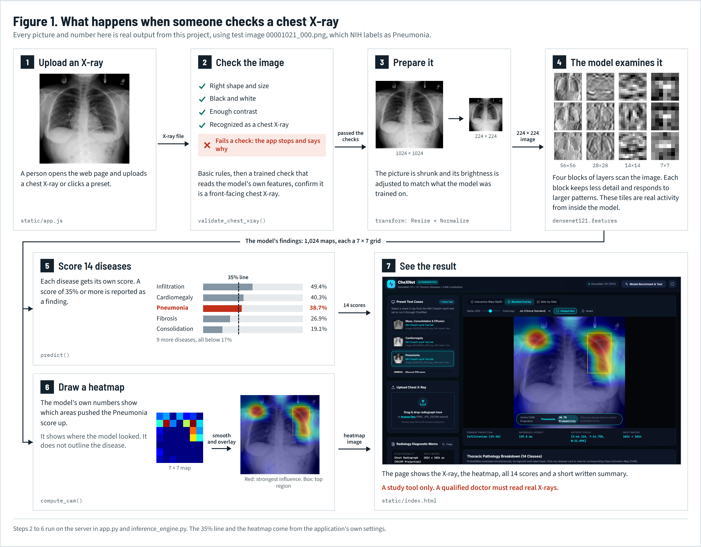
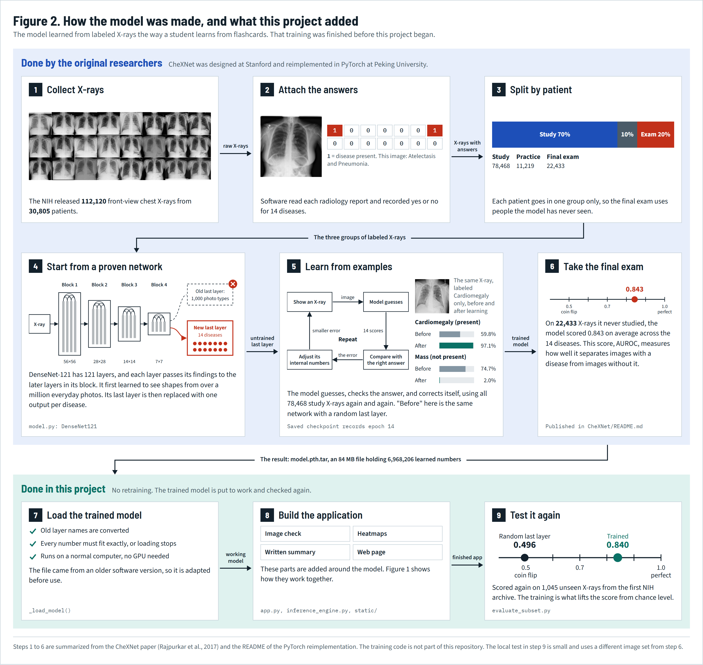

# Pneumonia Detection from Chest X-Rays

A web application that analyzes a frontal chest X-ray with the CheXNet deep learning model. It gives a score for pneumonia and 13 other chest diseases, and it shows a heatmap of the image regions behind each score.

This is an academic project. It is not a medical device and must not be used to diagnose patients.

## Contents

1. [The problem](#1-the-problem)
2. [The solution](#2-the-solution)
3. [The dataset](#3-the-dataset)
4. [The model](#4-the-model)
5. [How a prediction is made](#5-how-a-prediction-is-made)
6. [Technical problems and how they are solved](#6-technical-problems-and-how-they-are-solved)
7. [Project structure](#7-project-structure)
8. [Installation and running](#8-installation-and-running)
9. [Using the application](#9-using-the-application)
10. [REST API](#10-rest-api)
11. [Testing and evaluation](#11-testing-and-evaluation)
12. [Results](#12-results)
13. [Limitations](#13-limitations)
14. [Future work](#14-future-work)
15. [Troubleshooting](#15-troubleshooting)
16. [References](#16-references)

## 1. The problem

Pneumonia is an infection of the lungs, and a chest X-ray is one of the most common tests used to look for it. Reading these images takes training and time, and several things make the task hard:

- Pneumonia can look very similar to other conditions on an X-ray, such as fluid, a collapsed lung region, or a mass.
- Findings can be subtle, and an expert is not always available to read the image.
- One patient can have several conditions at once, so choosing a single answer is not enough.
- A score alone is hard to trust. A reader needs to see which part of the image produced it.

The project therefore has four goals:

| Goal | How it is met |
|---|---|
| Detect pneumonia and related diseases in one pass | A multi-label model with 14 independent outputs |
| Show why a score was given | A Class Activation Map (heatmap) for each disease |
| Be usable without machine learning knowledge | A browser interface with presets and file upload |
| Avoid scoring images that are not chest X-rays | A validation step that runs before the model |

## 2. The solution



```
Browser (upload or preset image)
        |
        v
Flask server (app.py)
        |
        v
1. Validate the image        -- not a chest X-ray --> rejection message
        |
        v
2. Resize to 224 x 224 and normalize
        |
        v
3. DenseNet-121 feature extractor  -->  7 x 7 x 1024 feature maps
        |
        +--> 4. Average pooling + linear layer + sigmoid  -->  14 disease scores
        |
        +--> 5. Class Activation Map  -->  heatmap and hotspot box
        |
        v
6. Rank the diseases and write a text summary
        |
        v
Browser shows the scores, heatmap, and summary
```

### What comes from where

| Part | Origin |
|---|---|
| CheXNet method | Rajpurkar et al., Stanford, 2017 |
| `model.py`, `read_data.py`, `model.pth.tar`, label lists, `localization/` | Open-source PyTorch reimplementation by Xinyu Weng, Nan Zhuang, Jingjing Tian and Yingcheng Liu, Peking University (see `CheXNet/README.md`) |
| X-ray images | NIH ChestX-ray14 dataset |
| `app.py`, `inference_engine.py`, `evaluate_subset.py`, `test_app.py`, `static/`, `start_interface.bat` | Web application and tooling built on top of the model for this project |

The model was **not trained** in this project. The application uses the existing trained checkpoint, `model.pth.tar`, and the repository has no training code.

## 3. The dataset

[NIH ChestX-ray14](https://nihcc.app.box.com/v/ChestXray-NIHCC) contains 112,120 frontal chest X-rays from 30,805 patients. Each image is a 1024 x 1024 PNG and can have any number of these 14 labels, or none (No Finding):

Atelectasis, Cardiomegaly, Effusion, Infiltration, Mass, Nodule, Pneumonia, Pneumothorax, Consolidation, Edema, Emphysema, Fibrosis, Pleural Thickening, Hernia.

The labels were extracted automatically from radiology reports with text mining, so some of them are wrong.

### Train, validation and test split

The lists in `CheXNet/ChestX-ray14/labels/` define the split used for this checkpoint:

| List | Images | Patients |
|---|---|---|
| `train_list.txt` | 78,468 | 21,528 |
| `val_list.txt` | 11,219 | 3,090 |
| `test_list.txt` | 22,433 | 6,187 |

No patient appears in more than one list. This matters because two X-rays of the same person look alike, and sharing a patient between training and testing would inflate the results.

Each line holds an image name followed by 14 values, 0 or 1, in the order of the disease list above.

### What is in this repository

The full image set is about 42 GB across 12 archives, so the images are not stored in Git. The `ChestX-ray14/images/` folder is listed in `.gitignore`.

Only the first archive was used here. It contains 4,999 images (1.9 GB extracted), and 1,045 of them, from 259 patients, are in the test list. Instructions to download it are in [section 8](#optional-download-the-dataset). The application itself does not need the dataset.

## 4. The model



CheXNet is a DenseNet-121 convolutional network adapted to chest X-rays.

- **Dense connections.** Each layer inside a block receives the feature maps of all earlier layers in that block. This reuses features and helps gradients reach early layers in a deep network.
- **Feature output.** For a 224 x 224 input, the final convolutional output is 7 x 7 with 1024 channels.
- **Classifier.** Global average pooling reduces those maps to a 1024-value vector. A linear layer maps it to 14 outputs.
- **Sigmoid output.** Each output goes through its own sigmoid. A softmax would force the diseases to compete, and these diseases can occur together.
- **Size.** The network has 6,968,206 parameters.

In the original paper the network starts from ImageNet weights and is trained with the Adam optimizer and a class-weighted binary cross-entropy loss, which compensates for how rare most diseases are. The checkpoint in this repository includes Adam optimizer state, which matches that training setup.

## 5. How a prediction is made

The logic is in `CheXNet/inference_engine.py`.

### Step 1: Validate the input

The model will return scores for any picture, including a photo of a cat, so `validate_chest_xray` checks each image in two stages. If either stage fails, the page shows the reason and no result.

**Stage 1: basic image rules**

| Check | Requirement |
|---|---|
| Shape | Width divided by height between 0.55 and 1.75 |
| Resolution | At least 120 x 120 pixels |
| Color | Close to grayscale (limits on saturation and on differences between color channels) |
| Contrast | Grayscale standard deviation of at least 12 |
| Not a document | At most 60% of pixels are nearly white |

**Stage 2: trained chest X-ray check**

Basic rules cannot separate a chest X-ray from other gray pictures such as a CT slice, a hand X-ray or a black-and-white photo. Two small logistic regression models make that decision. Both read the 1,024 features CheXNet already computes for the image, and one also reads a 24 x 24 summary of the image layout. An image must pass both. The fitted values are stored in `CheXNet/chest_xray_check.npz`.

The check was trained on two groups of images:

- **Real frontal chest X-rays:** NIH training and validation images, copies of those with varied exposure and cropping, and 498 X-rays from outside NIH (the public COVID-19 Image Data Collection and Wikimedia Commons).
- **Other pictures (2,495):** color and black-and-white photos, documents, screenshots, drawings, anatomy illustrations, CT, MRI, ultrasound, X-rays of other body parts, side-view chest X-rays, and upside-down, sideways or inverted X-rays.

Measured results:

| Images | Result |
|---|---|
| NIH test images, never used for training | 13 of 1,045 wrongly rejected (1.2%) |
| Chest X-rays from other hospitals\* | 18 of 450 wrongly rejected (4.0%) |
| Chest X-rays from the web\* | 7 of 48 wrongly rejected (14.6%) |
| Other pictures\* | 5 of 2,495 wrongly accepted (0.20%) |
| Other pictures, with that whole type left out of training | 17 of 2,495 wrongly accepted (0.68%) |

\* Each image was scored by a model that did not train on it or on others from the same patient or source page.

The earlier fixed rules accepted 843 of the same 2,495 pictures (33.8%) and rejected 70 of the 1,045 NIH test images (6.7%). No check of this kind is perfect (see [Limitations](#13-limitations)).

### Step 2: Preprocess

The image is converted to RGB, resized to 224 x 224, and normalized with the ImageNet mean and standard deviation.

### Step 3: Run the model

The image passes through the DenseNet features, average pooling, the linear layer, and a sigmoid. The result is 14 scores between 0 and 1.

### Step 4: Rank and label

Diseases are sorted by score and labeled:

| Score | Severity label |
|---|---|
| 50% or more | High Risk |
| 20% to 49% | Moderate |
| Below 20% | Low / Normal |

The text summary treats a score of 35% or more as a positive finding and 15% to 35% as borderline.

### Step 5: Build the heatmap

The Class Activation Map for disease `c` is a weighted sum of the final feature maps, using that disease's weights from the linear layer:

```
M_c(x, y) = sum over k of  w_c,k * f_k(x, y)
```

Here `f_k` is feature map `k` and `w_c,k` is the classifier weight connecting it to disease `c`. The map is then processed as follows:

1. Negative values are set to zero, and the map is scaled to the range 0 to 1.
2. It is resized from 7 x 7 to the size of the original image.
3. A colormap is applied and the result is blended over the X-ray.
4. The peak point is recorded, and the largest region above 65% of the maximum becomes the hotspot box.

### Step 6: Write the summary

`_generate_report` fills a text template from the scores. It is a summary of the numbers and is not written by a radiologist.

## 6. Technical problems and how they are solved

| Problem | Solution |
|---|---|
| The checkpoint was saved with an old version of torchvision that named layers differently (`norm.1` instead of `norm1`) | A regular expression in `_load_model` renames the keys, and the weights are then loaded in strict mode so any mismatch raises an error |
| The checkpoint was saved through `DataParallel`, which adds a `module.` prefix to every key | The prefix is removed while loading |
| Several diseases can be present at once | A sigmoid per disease, with a separate threshold check for each |
| A score without an explanation is hard to trust | Class Activation Maps for all 14 diseases |
| Recomputing the network every time the user selects another disease would waste time | The feature maps from the last image are cached, and `/api/recompute_cam` reuses them without another forward pass |
| Users can upload anything | The validation step rejects unsuitable images before the model runs |
| Smoothing a heatmap can push values slightly outside the 0 to 1 range, which wraps around to the wrong color and misplaces the hotspot box | Values are clipped to the 0 to 1 range before they are converted to colors |
| Not every computer has a GPU | The engine uses CUDA when available and otherwise falls back to CPU. The checkpoint is always loaded through the CPU first |
| The dataset is too large for Git and for a quick setup | Images are ignored by Git, and the application works without them |
| Demo images must not be images the model was trained on | All five presets come from `test_list.txt` (see below) |
| A full evaluation needs a GPU and all 42 GB | `evaluate_subset.py` scores whichever test images are present and runs on a CPU |

### How the preset images were chosen

Each preset is the first image in `test_list.txt`, within the first archive, that matches a fixed rule: only that label where possible, passes validation, and comes from a patient not already used. The model's output played no part in the choice, so some presets show the model getting a case wrong. They were left in because they show its real behavior.

## 7. Project structure

```
Pneumonia Detection/
├── README.md                  This document
├── start_interface.bat        Starts the server and opens the browser on Windows
├── docs/                      Workflow and model diagrams
└── CheXNet/
    ├── app.py                 Flask server and REST API
    ├── inference_engine.py    Validation, prediction, heatmaps, text summary
    ├── model.py               DenseNet-121 definition and full evaluation script
    ├── read_data.py           PyTorch dataset for the image lists
    ├── evaluate_subset.py     CPU evaluation on the test images available locally
    ├── test_app.py            Automated tests
    ├── model.pth.tar          Trained checkpoint
    ├── chest_xray_check.npz   Trained check that recognizes chest X-rays
    ├── README.md              README of the original reimplementation
    ├── samples/               Five preset X-rays from the test list
    ├── localization/          Example heatmaps from the original reimplementation
    ├── static/
    │   ├── index.html         Page layout
    │   ├── app.js             Interface logic and API calls
    │   └── style.css          Styling
    └── ChestX-ray14/
        ├── images/            Dataset images (not in Git)
        └── labels/            Train, validation and test lists
```

## 8. Installation and running

### Requirements

- Python 3.12 (tested with 3.12.10)
- Windows 11 was used for testing. The Python code has no Windows-specific parts, but `start_interface.bat` runs only on Windows
- Internet access the first time, to install packages and to download about 30 MB of ImageNet DenseNet weights, which `model.py` loads before the checkpoint replaces them
- A GPU is optional

### Install

From the repository root, once:

```powershell
cd CheXNet
python -m pip install torch torchvision flask flask-cors pillow numpy opencv-python scikit-learn requests
```

Tested versions: torch 2.15.0, torchvision 0.29.2, flask 3.1.3, flask-cors 6.0.5, pillow 13.0.0, numpy 2.5.4, opencv-python 5.0.0.93, scikit-learn 1.9.1, requests 2.34.2.

On Windows this installs the CPU build of PyTorch, which is enough for the application. To use an NVIDIA GPU, get the install command from [pytorch.org](https://pytorch.org/get-started/locally/). The application detects CUDA automatically.

### Run

```powershell
cd CheXNet
python app.py
```

Wait for `Running on http://127.0.0.1:5000`, then open <http://localhost:5000>. Press `Ctrl+C` in the terminal to stop the server.

On Windows you can double-click `start_interface.bat` instead. It opens the browser immediately, before the model has finished loading, so refresh the page if it does not connect at first.

To use a different port:

```powershell
$env:PORT = 8080
python app.py
```

### Optional: download the dataset

The application does not need this. It is only for `evaluate_subset.py` and `model.py`. From the repository root:

```powershell
cd CheXNet\ChestX-ray14
curl.exe -L -A "Mozilla/5.0" -o images_001.tar.gz "https://nihcc.box.com/shared/static/vfk49d74nhbxq3nqjg0900w5nvkorp5c.gz"
tar -xzf images_001.tar.gz --strip-components=1 -C images
del images_001.tar.gz
```

The other 11 archives are linked from the [NIH download page](https://nihcc.app.box.com/v/ChestXray-NIHCC).

## 9. Using the application

1. **Choose an image.** Click one of the **Preset Test Cases** on the left, or drag a PNG, JPG or WebP file onto **Upload Chest X-Ray**. The first preset runs automatically when the page opens.
2. **Read the disease cards.** **Thoracic Pathology Breakdown** lists all 14 diseases, highest score first, with colors for High, Moderate and Low.
3. **Switch the heatmap.** Click any disease card to see the heatmap for that disease.
4. **Change the view.** The tabs above the image are:
   - **Interactive Wipe (Split):** drag the handle to compare the original image with the heatmap.
   - **Blended Overlay:** the heatmap over the X-ray.
   - **Side-by-Side:** both images next to each other.
5. **Adjust the display.** **Alpha** sets heatmap strength, **Colormap** changes the colors, **Hotspot Box** shows or hides the box around the strongest region, and **Invert** reverses the grayscale.
6. **Read the summary.** **Radiology Diagnostic Memo** gives the main finding in text, and **Copy** puts it on the clipboard.
7. **Check performance.** **Model Benchmark & Test** runs 15 predictions and shows latency, and it also lists the published AUROC values. The info button next to it describes the architecture.

If an image fails validation, the page shows **Sample Not Acceptable** with the reason and does not run the model.

## 10. REST API

| Method | Path | Purpose |
|---|---|---|
| GET | `/` | Web page |
| GET | `/api/info` | Model details, device, published AUROC values |
| GET | `/api/samples` | List of preset images |
| GET | `/samples/<file>` | A preset image |
| POST | `/api/predict` | Scores and heatmaps for an image |
| POST | `/api/recompute_cam` | Heatmap for another disease on the last image |
| POST | `/api/benchmark` | 15 timed predictions on three presets |

`/api/predict` takes form data: `file` (an upload) or `sample_id` (a preset name), plus the optional fields `disease_idx`, `colormap` (`jet`, `turbo`, `inferno`, `plasma`, `viridis`) and `alpha` (default 0.45).

`/api/recompute_cam` takes JSON with `disease_idx`, `colormap` and `alpha`.

Example:

```powershell
curl.exe -X POST -F "sample_id=sample_pneumonia.png" http://localhost:5000/api/predict
```

## 11. Testing and evaluation

### Automated tests

Start the server in one terminal, then run this in a second terminal from the `CheXNet` folder:

```powershell
python test_app.py
```

The 13 tests cover model loading, prediction, heatmap recomputation, acceptance of the preset X-rays, rejection of color, blank, altered and non-X-ray images, and the API endpoints. All 13 pass.

### Evaluation on the local test images

```powershell
cd CheXNet
python evaluate_subset.py
```

This scores every `test_list.txt` image found in `ChestX-ray14/images/` and prints the AUROC per disease. With the first archive it takes about two minutes on a CPU.

Add `--untrained` to score the same network with a random last layer instead. Its mean AUROC is 0.496, which is chance level, compared with 0.840 for the trained model.

### Full evaluation

`python model.py` is the original evaluation script. It requires an NVIDIA GPU and all 12 archives, because it stops at the first listed image that is missing. It was not run for this project.

## 12. Results

AUROC measures how well a score separates positive and negative images. A value of 0.5 is random and 1.0 is perfect.

| Disease | Published | Measured here | Positive images here |
|---|---|---|---|
| Atelectasis | 0.8294 | 0.7954 | 103 |
| Cardiomegaly | 0.9165 | 0.9690 | 51 |
| Effusion | 0.8870 | 0.8722 | 130 |
| Infiltration | 0.7143 | 0.6871 | 177 |
| Mass | 0.8597 | 0.8067 | 26 |
| Nodule | 0.7873 | 0.6828 | 54 |
| **Pneumonia** | **0.7745** | **0.8563** | **11** |
| Pneumothorax | 0.8726 | 0.8680 | 52 |
| Consolidation | 0.8142 | 0.8354 | 47 |
| Edema | 0.8932 | 0.9051 | 12 |
| Emphysema | 0.9254 | 0.8737 | 21 |
| Fibrosis | 0.8304 | 0.8257 | 53 |
| Pleural Thickening | 0.7831 | 0.8301 | 44 |
| Hernia | 0.9104 | 0.9528 | 10 |
| **Mean** | **0.8427** | **0.8400** | |

- **Published** values are from the original reimplementation's README. They use the whole test set and ten-crop averaging, and they were not reproduced here.
- **Measured here** values come from `evaluate_subset.py` on 1,045 test images from 259 patients, using the application's single-resize preprocessing.

The local subset is small. Pneumonia, Edema and Hernia have only 10 to 12 positive images each, so the higher values for those diseases should not be read as an improvement.

### Pneumonia at the application's 35% threshold

| | Scored 35% or more | Scored below 35% |
|---|---|---|
| **Labeled Pneumonia** | 10 | 1 |
| **Not labeled Pneumonia** | 449 | 585 |

The model flagged 10 of the 11 pneumonia images but also 449 of the 1,034 others. High sensitivity with many false alarms means the score works better for screening than for confirming pneumonia, and most images it flags will not have the disease.

### Preset images

| Preset | Source image | NIH labels | Highest three scores | Pneumonia score |
|---|---|---|---|---|
| Mass, Consolidation & Effusion | `00000920_001.png` | Mass, Consolidation, Effusion | Consolidation 86.5%, Pneumonia 84.9%, Pleural Effusion 84.9% | 84.9% |
| Cardiomegaly | `00000864_000.png` | Cardiomegaly | Cardiomegaly 97.1%, Pleural Effusion 37.1%, Infiltration 27.4% | 22.3% |
| Pneumonia | `00001021_000.png` | Pneumonia | Infiltration 49.4%, Cardiomegaly 40.3%, Pneumonia 38.7% | 38.7% |
| Pleural Effusion | `00000402_009.png` | Effusion | Pulmonary Fibrosis 91.1%, Pleural Thickening 90.1%, Consolidation 74.8% | 41.4% |
| No Finding | `00001215_000.png` | No Finding | Cardiomegaly 79.2%, Pulmonary Fibrosis 37.0%, Pleural Thickening 30.7% | 23.3% |

These five cases illustrate how the application behaves and do not measure accuracy. The Cardiomegaly and combined cases agree with their labels, the Pneumonia case is only partly right, and the Effusion and No Finding cases disagree with their labels.

Prediction took about 100 to 200 ms per image on the CPU of the test computer.

## 13. Limitations

- **Not for clinical use.** The system has no clinical validation.
- **Scores are not true probabilities.** A score of 40% does not mean a 40% chance of disease. Pneumonia is present in about 1% of the local test images, but 44% of them scored above the 35% threshold. The class-weighted training loss described in the CheXNet paper is a likely reason.
- **Imperfect labels.** The labels were mined from reports, so both training and evaluation inherit their errors.
- **Heatmaps are coarse.** They begin as a 7 x 7 grid and show where the model responded, which is not an exact outline of a lesion.
- **The validator can still make mistakes.** It wrongly rejected 1.2% of the NIH test images and 4.0% of chest X-rays from other hospitals, and it wrongly accepted 5 of 2,495 other pictures: two collages of chest films, a shoulder X-ray, a spine X-ray and an ultrasound image. Its training pictures came from a limited set of sources, so a type of image it has never seen could still pass.
- **Single-resize preprocessing.** The application does not use the ten-crop averaging behind the published values, which trades some accuracy for speed.
- **Partial evaluation.** Local results cover one of the 12 archives.
- **Single-user design.** The heatmap cache holds one image for the whole server, so simultaneous users could affect each other's heatmaps.
- **Local demonstration only.** It uses the Flask development server with no login, and it listens on all network interfaces.
- **No DICOM support.** Files must first be exported to PNG, JPG or WebP.

## 14. Future work

- Run the full evaluation on all 12 archives.
- Calibrate the scores and choose a separate threshold for each disease.
- Train the chest X-ray check on images from more hospitals.
- Add DICOM input.
- Keep cached data per request so several users can work at once.
- Retrain on a larger and more recent dataset with better labels.

## 15. Troubleshooting

| Symptom | Fix |
|---|---|
| `ModuleNotFoundError` | Run the install command in [section 8](#install) |
| The browser cannot connect | The server may still be loading, so wait for `Running on` and refresh |
| Port 5000 is already in use | Set a different port as shown in [section 8](#run) |
| `Checkpoint not found` when running tests | Run `test_app.py` from inside the `CheXNet` folder |
| Connection errors in the API tests | Start `python app.py` in another terminal first |
| `OpenBLAS error: Memory allocation still failed` | Run `$env:OPENBLAS_NUM_THREADS = 1` in that terminal and try again. This can happen when a second Python process starts while the server is running |
| `Chest X-ray check not found` | Make sure `CheXNet/chest_xray_check.npz` is in the project |
| A real X-ray shows **Sample Not Acceptable** | The check rejects a small share of real X-rays, and tinted images fail the color rule. Use a frontal grayscale image without large borders |

## 16. References

1. Rajpurkar, P., et al. *CheXNet: Radiologist-Level Pneumonia Detection on Chest X-Rays with Deep Learning.* arXiv:1711.05225, 2017.
2. Wang, X., et al. *ChestX-ray8: Hospital-scale Chest X-ray Database and Benchmarks on Weakly-Supervised Classification and Localization of Common Thorax Diseases.* CVPR 2017.
3. Huang, G., et al. *Densely Connected Convolutional Networks.* CVPR 2017.
4. Cohen, J. P., et al. *COVID-19 Image Data Collection.* arXiv:2003.11597, 2020.
4. Zhou, B., et al. *Learning Deep Features for Discriminative Localization.* CVPR 2016.
5. Weng, X., Zhuang, N., Tian, J., Liu, Y. *CheXNet for Classification and Localization of Thoracic Diseases.* <https://github.com/arnoweng/CheXNet>
